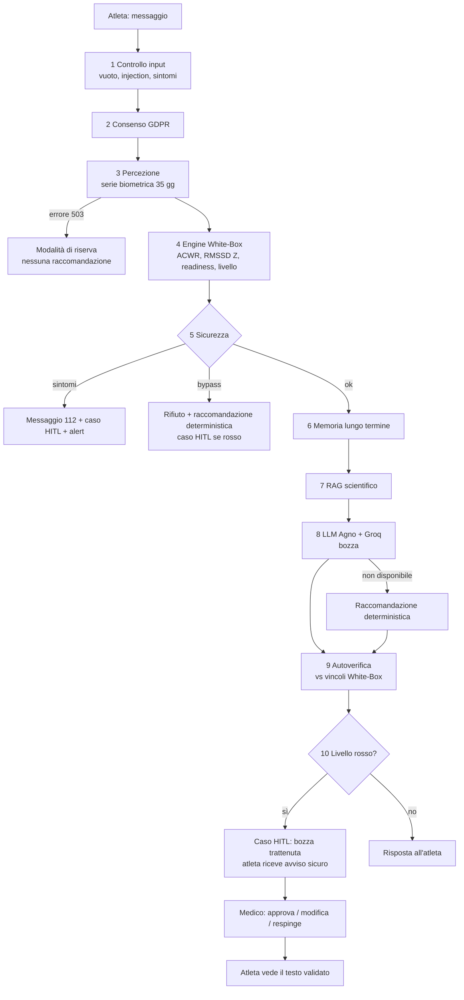

# Architettura di BioPulse-Agent

## Flusso di una richiesta

Ogni passo emette un evento `trace` via SSE: è la *Agent Thought Trace* mostrata nell'interfaccia.

## Formule e soglie (`backend/app/whitebox/metrics.py`)

| Grandezza | Definizione |
|---|---|
| RMSSD | √(media((RRᵢ₊₁ − RRᵢ)²)) |
| Carico di sessione | RPE × minuti (Foster) |
| ACWR | media carico 7 g / media carico 28 g; calcolato solo se ciascuno dei 28 giorni ha un carico registrato. Riposo esplicito = 0; giorno senza record = dato mancante e ACWR non disponibile. |
| Z-score HRV / FC riposo | (media mobile 3 g − media baseline) / dev. std. baseline; baseline = i 28 giorni prima della finestra di 3 giorni; richiede ≥ 7 misure |

| Segnale | Soglia | Livello |
|---|---|---|
| ACWR | > 1.5 | rosso |
| ACWR | 1.3–1.5 | giallo |
| ACWR | < 0.8 | informativo |
| Z-score HRV | < −1.5 | rosso |
| Z-score HRV | < −1.0 | giallo |
| Z-score FC a riposo | > +1.5 | giallo |
| SpO₂ | < 92% | rosso |
| Efficienza sonno | < 75% | giallo |

**Readiness (0-100)** = 100 meno penalità (ACWR −40/−20/−5, HRV −35/−20/−8, FC −15, sonno −10/−5, SpO₂ −25), limitata a 0-100 e a **39 se il livello è rosso**. Il livello è rosso se c'è almeno un segnale rosso; giallo se c'è un segnale giallo o readiness < 70; verde solo se l'ACWR è calcolabile e non ci sono segnali gialli/rossi. Altrimenti il livello è `unknown` e non si formula una raccomandazione personalizzata.

Se manca l'ACWR e non ci sono altri segnali gialli/rossi, il livello è `unknown` e non viene mostrato un readiness verde. Le soglie e le formule sono euristiche del prototipo, non validate clinicamente. La media mobile a 3 giorni su HRV e FC è una scelta progettuale da validare; i risultati sintetici non dimostrano prestazioni cliniche.

## Modello dati

`athletes` · `daily_metrics` (unico per atleta+giorno) · `memory_notes` (testo + embedding) · `knowledge_docs` (testo + embedding) · `hitl_cases` (stato, bozza, testo finale, revisore) · `alert_log`. Su PostgreSQL le colonne `embedding` sono `vector(256)` con `pgvector` (distanza coseno); su SQLite (solo test) sono JSON.

## API

| Metodo e percorso | Scopo |
|---|---|
| `GET /api/health` | stato di LLM, memoria, database |
| `GET /api/auth/options` | indica se la registrazione atleta è abilitata nell'ambiente locale demo |
| `POST /api/auth/register` | crea un account atleta solo in sviluppo/demo, con consenso inizialmente disattivato |
| `POST /api/auth/login`, `GET /api/auth/session`, `POST /api/auth/logout` | sessione utente con cookie HttpOnly e CSRF |
| `PUT /api/athletes/{id}/profile` | aggiornamento nome e categoria descrittiva, solo atleta proprietario |
| `POST /api/demo/seed` | crea l'atleta con 42 giorni simulati (4 scenari) |
| `POST /api/athletes/{id}/telemetry` | ingestione e sanificazione dati |
| `GET /api/athletes/{id}/dashboard` | report e serie 28 giorni |
| `PUT /api/athletes/{id}/consent` | consensi dati / avvisi |
| `DELETE /api/athletes/{id}/data?scope=memory\|all` | cancellazione (GDPR) |
| `POST /api/chat` | SSE: eventi `trace`, `message`, `done` |
| `GET /api/athletes/{id}/validated` | testi già validati dal professionista |
| `GET /api/hitl/cases`, `POST /api/hitl/cases/{id}/decision`, `GET /api/hitl/alerts` | area professionista autenticata tramite sessione e ruolo assegnato |

Documentazione interattiva: <http://localhost:8000/docs>.

Il seed demo conserva i consensi esistenti se non vengono specificati nella richiesta. Se il consenso al trattamento dei dati è revocato, il seed viene rifiutato (`403`) finché l'atleta non lo riattiva esplicitamente.

## Decisioni di progetto

- **LLM solo in lettura**: i tool di scrittura/alert sono invocati dalla pipeline.
- **Fallback a cascata**: LLM con tool → LLM senza tool (Llama può sbagliare il function calling) → risposta deterministica.
- **Redis opzionale**: se non raggiungibile la memoria breve passa in-process e l'`/api/health` lo segnala.
- **Embedding locale**: feature hashing a 256 dimensioni, zero download; sostituibile in `embeddings.py`.
- **Streaming**: SSE implementato con `fetch` e parsing manuale, senza dipendere dalla versione di AI SDK UI.

## Limiti e prossimi passi

Il database usa migrazioni versionate in `backend/migrations/`; fuori dai test l'app non crea tabelle implicitamente. I comandi per database nuovi/esistenti e backup/ripristino sono in `docs/OPERATIONS.md`. Le fonti della base di conoscenza restano da verificare e la validazione specialistica è descritta in `docs/VALIDATION_GATE.txt`. Wearable reale e notifiche a professionisti restano fuori ambito e non collegati.
